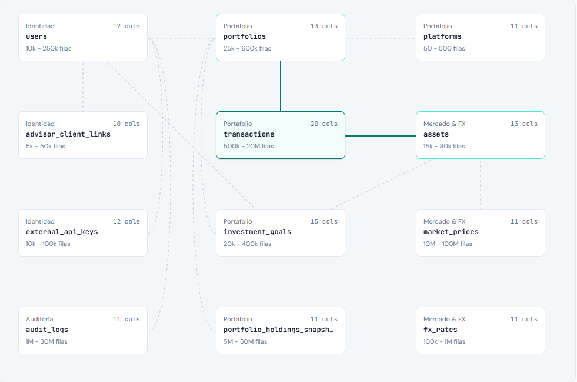
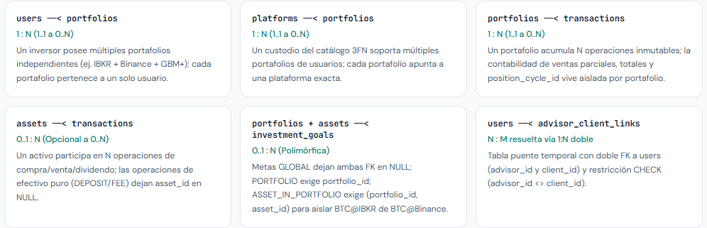

# 5. Data Base — AurumCap (PostgreSQL 16 · 3FN & Alembic)

Modelo relacional estrictamente normalizado en Tercera Forma Normal (**3FN**, 12 entidades) con precisión `NUMERIC(20,8)`, columnas estándar de ciclo de vida (`status`, `valid_from`, `valid_to`), auditoría (`created_at`, `updated_at`), concurrencia optimista (`row_version`) y gobernanza de cambios vía **Alembic Async**.

## 1. Diagrama E-R

## 2. Cardinalidades Principales

## 3. Diccionario de Datos

### users (Identidad · 10k - 250k filas)
Cuentas de inversores, asesores y auditores con país fiscal, moneda de preferencia y vigencia temporal.

- **Normalización:** 3FN: Todos los atributos no clave (email, full_name, role, country_code, display_currency, status, vigencia) dependen exclusivamente de la PK id sin dependencias transitivas.

| Columna | Tipo PostgreSQL | Nulable | Llave | Descripción y Regla de Negocio |
|---|---|---|---|---|
| `id` | `UUID` | NOT NULL | PK | Identificador UUIDv7 ordenable por tiempo |
| `email` | `VARCHAR(255)` | NOT NULL | UQ | Correo único normalizado en minúsculas |
| `password_hash` | `TEXT` | NOT NULL | — | Hash Argon2id |
| `full_name` | `VARCHAR(120)` | NOT NULL | — | Nombre completo del usuario (registro y UI) |
| `role` | `VARCHAR(32)` | NOT NULL | — | inversor_retail | asesor_financiero | auditor_compliance | admin_plataforma |
| `country_code` | `CHAR(2)` | NOT NULL | — | ISO-3166-1 alpha-2 (MX, CO, BR, CL, AR, PE) |
| `display_currency` | `CHAR(3)` | NOT NULL | — | Moneda de visualización preferida |
| `status` | `VARCHAR(24)` | NOT NULL | — | ACTIVE | SUSPENDED | CLOSED |
| `valid_from` | `TIMESTAMPTZ` | NOT NULL | — | Inicio de vigencia de la cuenta (UTC) |
| `valid_to` | `TIMESTAMPTZ` | NULL | — | Fin de vigencia / cierre de cuenta (NULL = activa) |
| `created_at` | `TIMESTAMPTZ` | NOT NULL | — | Fecha de creación inmutable UTC |
| `updated_at` | `TIMESTAMPTZ` | NOT NULL | — | Última actualización UTC |
| `row_version` | `INTEGER` | NOT NULL | — | Control de concurrencia optimista (OCC) |

### advisor_client_links (Identidad · 5k - 50k filas)
Mandatos temporales de visualización entre un asesor financiero y un inversor.

- **Normalización:** 3FN: Representa exclusivamente la relación N:M con atributos propios del mandato (scope, status, valid_from/valid_to), evitando duplicar datos de usuario.

| Columna | Tipo PostgreSQL | Nulable | Llave | Descripción y Regla de Negocio |
|---|---|---|---|---|
| `id` | `UUID` | NOT NULL | PK | Identificador del vínculo |
| `advisor_id` | `UUID` | NOT NULL | FK → users.id | Usuario asesor |
| `client_id` | `UUID` | NOT NULL | FK → users.id | Inversor propietario |
| `scope` | `VARCHAR(24)` | NOT NULL | — | READ_ONLY | REBALANCE_SUGGEST |
| `status` | `VARCHAR(24)` | NOT NULL | — | PENDING | ACTIVE | REVOKED | EXPIRED |
| `valid_from` | `TIMESTAMPTZ` | NOT NULL | — | Inicio efectivo del mandato UTC |
| `valid_to` | `TIMESTAMPTZ` | NULL | — | Fecha de expiración o revocación (NULL = vigente) |
| `created_at` | `TIMESTAMPTZ` | NOT NULL | — | Fecha de creación UTC |
| `updated_at` | `TIMESTAMPTZ` | NOT NULL | — | Última actualización UTC |
| `row_version` | `INTEGER` | NOT NULL | — | Versión optimista de fila |

### external_api_keys (Identidad · 10k - 100k filas)
Credenciales de solo lectura para que la app externa Finanzas consulte resúmenes patrimoniales.

- **Normalización:** 3FN: Desacopla la autorización externa del registro users; la vigencia temporal se modela únicamente mediante status + valid_from/valid_to sin columnas redundantes.

| Columna | Tipo PostgreSQL | Nulable | Llave | Descripción y Regla de Negocio |
|---|---|---|---|---|
| `id` | `UUID` | NOT NULL | PK | Identificador de la credencial |
| `user_id` | `UUID` | NOT NULL | FK → users.id | Titular del patrimonio expuesto |
| `label` | `VARCHAR(80)` | NOT NULL | — | Nombre descriptivo (ej. App Finanzas) |
| `key_prefix` | `VARCHAR(16)` | NOT NULL | — | Prefijo visible (aurum_ro_8f42) |
| `key_hash` | `CHAR(64)` | NOT NULL | UQ | Hash SHA-256 del token secreto |
| `scopes` | `VARCHAR(64)` | NOT NULL | — | external:summary:read |
| `status` | `VARCHAR(24)` | NOT NULL | — | ACTIVE | REVOKED | EXPIRED |
| `valid_from` | `TIMESTAMPTZ` | NOT NULL | — | Fecha/hora de emisión UTC |
| `valid_to` | `TIMESTAMPTZ` | NULL | — | Expiración o revocación efectiva (NULL = sin caducidad) |
| `created_at` | `TIMESTAMPTZ` | NOT NULL | — | Creación UTC |
| `updated_at` | `TIMESTAMPTZ` | NOT NULL | — | Última actualización UTC |
| `row_version` | `INTEGER` | NOT NULL | — | Versión optimista de fila |

### audit_logs (Auditoría · 1M - 30M filas)
Bitácora inmutable append-only de mutaciones de ledger, metas y accesos externos.

- **Normalización:** 3FN: Registra eventos históricos inmutables dependientes de su PK secuencial id; actor_user_id referencia users sin duplicar atributos de identidad.

| Columna | Tipo PostgreSQL | Nulable | Llave | Descripción y Regla de Negocio |
|---|---|---|---|---|
| `id` | `BIGINT` | NOT NULL | PK | Secuencia incremental estricta |
| `actor_user_id` | `UUID` | NULL | FK → users.id | Usuario o titular del token |
| `action` | `VARCHAR(64)` | NOT NULL | — | TX_CREATED | FULL_EXIT | GOAL_CREATED | EXTERNAL_SUMMARY_READ |
| `entity_type` | `VARCHAR(32)` | NOT NULL | — | Entidad afectada |
| `metadata_json` | `JSONB` | NOT NULL | — | Diff antes/después e IP |
| `status` | `VARCHAR(24)` | NOT NULL | — | RECORDED | VERIFIED |
| `valid_from` | `TIMESTAMPTZ` | NOT NULL | — | Inicio de retención auditable UTC |
| `valid_to` | `TIMESTAMPTZ` | NULL | — | Fin de ventana legal de retención (NULL = permanente) |
| `created_at` | `TIMESTAMPTZ` | NOT NULL | — | Timestamp inmutable UTC |
| `updated_at` | `TIMESTAMPTZ` | NOT NULL | — | Timestamp de verificación UTC |
| `row_version` | `INTEGER` | NOT NULL | — | Versión de fila (inmutable = 1 en RECORDED) |

### portfolios (Portafolio · 25k - 600k filas)
Contenedores por plataforma/custodio con inventario y costo base aislado.

- **Normalización:** 3FN: Extrae los metadatos del custodio a la tabla catálogo platforms mediante FK platform_id, eliminando dependencias transitivas por nombre de broker.

| Columna | Tipo PostgreSQL | Nulable | Llave | Descripción y Regla de Negocio |
|---|---|---|---|---|
| `id` | `UUID` | NOT NULL | PK | Identificador del portafolio |
| `user_id` | `UUID` | NOT NULL | FK → users.id | Propietario |
| `platform_id` | `UUID` | NOT NULL | FK → platforms.id | Custodio/plataforma normalizado (3FN) |
| `name` | `VARCHAR(80)` | NOT NULL | — | Nombre (ej. IBKR Largo Plazo) |
| `base_currency` | `CHAR(3)` | NOT NULL | — | Moneda contable base |
| `accounting_method` | `VARCHAR(8)` | NOT NULL | — | WAC | FIFO |
| `fx_source_preference` | `VARCHAR(24)` | NOT NULL | — | OFFICIAL | FIX_BANXICO | TRM | MEP | CCL |
| `status` | `VARCHAR(24)` | NOT NULL | — | ACTIVE | FROZEN | ARCHIVED |
| `valid_from` | `TIMESTAMPTZ` | NOT NULL | — | Fecha de apertura del portafolio UTC |
| `valid_to` | `TIMESTAMPTZ` | NULL | — | Fecha de cierre/archivado (NULL = activo) |
| `created_at` | `TIMESTAMPTZ` | NOT NULL | — | Creación UTC |
| `updated_at` | `TIMESTAMPTZ` | NOT NULL | — | Última actualización UTC |
| `row_version` | `INTEGER` | NOT NULL | — | Control optimista de concurrencia |

### transactions (Portafolio · 500k - 20M filas)
Libro mayor inmutable con ventas parciales/totales, position_cycle_id y P&L realizado.

- **Normalización:** 3FN: Todos los atributos monetarios y de lote dependen estrictamente de la PK id; la descripción del activo y plataforma viven en assets y portfolios.

| Columna | Tipo PostgreSQL | Nulable | Llave | Descripción y Regla de Negocio |
|---|---|---|---|---|
| `id` | `UUID` | NOT NULL | PK | ID único de transacción |
| `portfolio_id` | `UUID` | NOT NULL | FK → portfolios.id | Plataforma/portafolio aislado |
| `asset_id` | `UUID` | NULL | FK → assets.id | Activo operado |
| `position_cycle_id` | `INTEGER` | NOT NULL | — | Ciclo de lote (incrementa al recomprar tras venta total) |
| `type` | `VARCHAR(16)` | NOT NULL | — | BUY | SELL | DIVIDEND | DEPOSIT | WITHDRAWAL | FEE |
| `sale_scope` | `VARCHAR(12)` | NULL | — | PARTIAL | FULL (solo en SELL) |
| `executed_at` | `TIMESTAMPTZ` | NOT NULL | — | Fecha/hora de ejecución en mercado |
| `quantity` | `NUMERIC(20,8)` | NOT NULL | — | Cantidad exacta (8 decimales) |
| `unit_price` | `NUMERIC(20,8)` | NOT NULL | — | Precio unitario en trade_currency |
| `fee_amount` | `NUMERIC(20,8)` | NOT NULL | — | Comisión de plataforma |
| `trade_currency` | `CHAR(3)` | NOT NULL | — | Moneda original |
| `fx_rate_to_base` | `NUMERIC(20,8)` | NOT NULL | — | Tasa FX histórica aplicada |
| `realized_pnl_base` | `NUMERIC(20,8)` | NULL | — | P&L realizado asentado en venta |
| `idempotency_hash` | `CHAR(64)` | NULL | UQ | SHA-256 anti-duplicados |
| `status` | `VARCHAR(24)` | NOT NULL | — | POSTED | VOIDED |
| `valid_from` | `TIMESTAMPTZ` | NOT NULL | — | Inicio de efecto contable en ledger UTC |
| `valid_to` | `TIMESTAMPTZ` | NULL | — | Timestamp de anulación lógica (NULL = vigente) |
| `created_at` | `TIMESTAMPTZ` | NOT NULL | — | Creación UTC |
| `updated_at` | `TIMESTAMPTZ` | NOT NULL | — | Última actualización UTC |
| `row_version` | `INTEGER` | NOT NULL | — | Control optimista de concurrencia |

### investment_goals (Portafolio · 20k - 400k filas)
Metas generales (GLOBAL) o específicas por activo en una plataforma (ASSET_IN_PORTFOLIO) sin tocar otros lotes.

- **Normalización:** 3FN: El progreso actual nunca se persiste como columna derivada; se calcula dinámicamente desde holdings vigentes según scope_type.

| Columna | Tipo PostgreSQL | Nulable | Llave | Descripción y Regla de Negocio |
|---|---|---|---|---|
| `id` | `UUID` | NOT NULL | PK | ID único de la meta |
| `user_id` | `UUID` | NOT NULL | FK → users.id | Inversor dueño de la meta |
| `name` | `VARCHAR(100)` | NOT NULL | — | Nombre (ej. Viaje Japón 2027) |
| `scope_type` | `VARCHAR(24)` | NOT NULL | — | GLOBAL | PORTFOLIO | ASSET_IN_PORTFOLIO |
| `portfolio_id` | `UUID` | NULL | FK → portfolios.id | Plataforma específica (si aplica) |
| `asset_id` | `UUID` | NULL | FK → assets.id | Activo específico dentro de esa plataforma |
| `target_amount` | `NUMERIC(20,8)` | NOT NULL | — | Monto objetivo |
| `target_currency` | `CHAR(3)` | NOT NULL | — | Moneda de la meta |
| `target_date` | `DATE` | NULL | — | Fecha objetivo financiera |
| `status` | `VARCHAR(24)` | NOT NULL | — | IN_PROGRESS | ACHIEVED | PAUSED | ARCHIVED |
| `valid_from` | `TIMESTAMPTZ` | NOT NULL | — | Inicio de vigencia de la meta UTC |
| `valid_to` | `TIMESTAMPTZ` | NULL | — | Cierre o cumplimiento de la meta (NULL = activa) |
| `created_at` | `TIMESTAMPTZ` | NOT NULL | — | Creación UTC |
| `updated_at` | `TIMESTAMPTZ` | NOT NULL | — | Última actualización UTC |
| `row_version` | `INTEGER` | NOT NULL | — | Control optimista de concurrencia |

### portfolio_holdings_snapshot (Portafolio · 5M - 50M filas)
Materialización diaria de valor mercado, costo base y factor TWR por portafolio.

- **Normalización:** 3FN: Clave primaria compuesta (portfolio_id, snapshot_date); cada métrica diaria depende funcionalmente de toda la clave compuesta.

| Columna | Tipo PostgreSQL | Nulable | Llave | Descripción y Regla de Negocio |
|---|---|---|---|---|
| `portfolio_id` | `UUID` | NOT NULL | FK → portfolios.id | Portafolio snapshot |
| `snapshot_date` | `DATE` | NOT NULL | PK | Fecha de cierre diario |
| `total_value_base` | `NUMERIC(20,8)` | NOT NULL | — | Valor de mercado |
| `cost_basis_base` | `NUMERIC(20,8)` | NOT NULL | — | Costo base vigente |
| `daily_twr_factor` | `NUMERIC(16,10)` | NOT NULL | — | Factor diario (1 + r_t) |
| `status` | `VARCHAR(24)` | NOT NULL | — | PROVISIONAL | FINAL | SUPERSEDED |
| `valid_from` | `TIMESTAMPTZ` | NOT NULL | — | Inicio de validez del snapshot UTC |
| `valid_to` | `TIMESTAMPTZ` | NULL | — | Timestamp en que fue reemplazado por recálculo (NULL = vigente) |
| `created_at` | `TIMESTAMPTZ` | NOT NULL | — | Creación UTC |
| `updated_at` | `TIMESTAMPTZ` | NOT NULL | — | Última actualización UTC |
| `row_version` | `INTEGER` | NOT NULL | — | Versión optimista tras recálculo retroactivo |

### platforms (Portafolio · 50 - 500 filas)
Catálogo normalizado 3FN de brokers, exchanges y custodios (IBKR, Binance, GBM+, Trii).

- **Normalización:** 3FN: Elimina repetición de cadenas broker_name y atributos de custodio en portfolios; garantiza integridad referencial única.

| Columna | Tipo PostgreSQL | Nulable | Llave | Descripción y Regla de Negocio |
|---|---|---|---|---|
| `id` | `UUID` | NOT NULL | PK | ID único del custodio/plataforma |
| `slug` | `VARCHAR(32)` | NOT NULL | UQ | Identificador canónico (ibkr, binance, gbm, trii) |
| `name` | `VARCHAR(80)` | NOT NULL | — | Nombre oficial de la plataforma |
| `platform_type` | `VARCHAR(24)` | NOT NULL | — | BROKER | CRYPTO_EXCHANGE | BANK_CUSTODIAN | WALLET |
| `country_scope` | `VARCHAR(16)` | NOT NULL | — | GLOBAL | MX | CO | BR | CL | AR | PE |
| `status` | `VARCHAR(24)` | NOT NULL | — | ACTIVE | DEPRECATED |
| `valid_from` | `TIMESTAMPTZ` | NOT NULL | — | Inicio de soporte en AurumCap UTC |
| `valid_to` | `TIMESTAMPTZ` | NULL | — | Fin de soporte (NULL = soportada) |
| `created_at` | `TIMESTAMPTZ` | NOT NULL | — | Creación UTC |
| `updated_at` | `TIMESTAMPTZ` | NOT NULL | — | Última actualización UTC |
| `row_version` | `INTEGER` | NOT NULL | — | Versión de catálogo |

### assets (Mercado & FX · 15k - 80k filas)
Catálogo maestro de instrumentos (Acciones US/LATAM, ETFs, CEDEARs, FIBRAs, Criptoactivos).

- **Normalización:** 3FN: Separa identidad del instrumento (ticker, exchange, asset_class, ratio) de sus series históricas de precios.

| Columna | Tipo PostgreSQL | Nulable | Llave | Descripción y Regla de Negocio |
|---|---|---|---|---|
| `id` | `UUID` | NOT NULL | PK | ID interno del activo |
| `ticker` | `VARCHAR(24)` | NOT NULL | — | Símbolo normalizado (VOO, BTC, WALMEX.MX) |
| `exchange` | `VARCHAR(16)` | NOT NULL | — | NASDAQ, NYSE, CRYPTO, BMV, BVC, BYMA |
| `name` | `VARCHAR(140)` | NOT NULL | — | Nombre del instrumento |
| `asset_class` | `VARCHAR(24)` | NOT NULL | — | EQUITY | ETF | CRYPTO | CEDEAR | FIBRA | BOND |
| `currency` | `CHAR(3)` | NOT NULL | — | Moneda de cotización |
| `underlying_ratio` | `NUMERIC(12,4)` | NULL | — | Ratio CEDEAR/ADR |
| `status` | `VARCHAR(24)` | NOT NULL | — | ACTIVE | DELISTED | SUSPENDED |
| `valid_from` | `TIMESTAMPTZ` | NOT NULL | — | Fecha de listado/alta UTC |
| `valid_to` | `TIMESTAMPTZ` | NULL | — | Fecha de deslistado o fusión (NULL = cotizando) |
| `created_at` | `TIMESTAMPTZ` | NOT NULL | — | Creación UTC |
| `updated_at` | `TIMESTAMPTZ` | NOT NULL | — | Última actualización UTC |
| `row_version` | `INTEGER` | NOT NULL | — | Control optimista de versión |

### market_prices (Mercado & FX · 10M - 100M filas)
Serie histórica diaria (EOD) de precios de cierre ajustados.

- **Normalización:** 3FN: Clave compuesta (asset_id, price_date); no almacena ticker ni moneda del activo para evitar anomalías de actualización.

| Columna | Tipo PostgreSQL | Nulable | Llave | Descripción y Regla de Negocio |
|---|---|---|---|---|
| `asset_id` | `UUID` | NOT NULL | FK → assets.id | Activo cotizado |
| `price_date` | `DATE` | NOT NULL | PK | Fecha de cierre |
| `close_price` | `NUMERIC(20,8)` | NOT NULL | — | Precio de cierre nominal |
| `adjusted_close` | `NUMERIC(20,8)` | NOT NULL | — | Cierre ajustado por splits/dividendos |
| `source` | `VARCHAR(24)` | NOT NULL | — | POLYGON | YAHOO | COINGECKO |
| `status` | `VARCHAR(24)` | NOT NULL | — | PROVISIONAL | FINAL | CORRECTED |
| `valid_from` | `TIMESTAMPTZ` | NOT NULL | — | Inicio de vigencia de la cotización UTC |
| `valid_to` | `TIMESTAMPTZ` | NULL | — | Fin de vigencia si fue corregida (NULL = oficial) |
| `created_at` | `TIMESTAMPTZ` | NOT NULL | — | Creación UTC |
| `updated_at` | `TIMESTAMPTZ` | NOT NULL | — | Última actualización UTC |
| `row_version` | `INTEGER` | NOT NULL | — | Versión de dato de cierre |

### fx_rates (Mercado & FX · 100k - 1M filas)
Serie histórica de tasas cambiarias diferenciando cotización oficial y financiera (MEP/CCL).

- **Normalización:** 3FN: Clave compuesta (base_currency, quote_currency, rate_date, source); cada tasa depende funcionalmente de la cuádruple clave.

| Columna | Tipo PostgreSQL | Nulable | Llave | Descripción y Regla de Negocio |
|---|---|---|---|---|
| `base_currency` | `CHAR(3)` | NOT NULL | PK | Moneda base (USD) |
| `quote_currency` | `CHAR(3)` | NOT NULL | PK | Moneda cotizada (MXN, COP, BRL, ARS...) |
| `rate_date` | `DATE` | NOT NULL | PK | Fecha de vigencia |
| `source` | `VARCHAR(24)` | NOT NULL | PK | FIX_BANXICO | TRM | PTAX | MEP | CCL |
| `rate` | `NUMERIC(20,8)` | NOT NULL | — | Tipo de cambio exacto |
| `status` | `VARCHAR(24)` | NOT NULL | — | FINAL | FALLBACK | CORRECTED |
| `valid_from` | `TIMESTAMPTZ` | NOT NULL | — | Inicio de validez cambiaria UTC |
| `valid_to` | `TIMESTAMPTZ` | NULL | — | Fin de vigencia si hubo revisión (NULL = vigente) |
| `created_at` | `TIMESTAMPTZ` | NOT NULL | — | Creación UTC |
| `updated_at` | `TIMESTAMPTZ` | NOT NULL | — | Última actualización UTC |
| `row_version` | `INTEGER` | NOT NULL | — | Versión de tasa cambiaria |

## 4. Relaciones entre Tablas

| Tabla Origen | Columna FK | Tabla Destino | Columna Ref | Notación | Opcionalidad | Integridad Referencial | Regla de Negocio |
|---|---|---|---|---|---|---|---|
| `portfolios` | `user_id` | `users` | `id` | `users (1) ──< (0..N) portfolios` | Obligatoria | `ON DELETE RESTRICT` | Todo portafolio pertenece a un único usuario propietario (inversor). |
| `portfolios` | `platform_id` | `platforms` | `id` | `platforms (1) ──< (0..N) portfolios` | Obligatoria | `ON DELETE RESTRICT` | Normalización 3FN: asocia cada portafolio a un custodio único (IBKR, Binance, GBM+, Trii). |
| `advisor_client_links` | `advisor_id` | `users` | `id` | `users (1) ──< (0..N) advisor_client_links [advisor]` | Obligatoria | `ON DELETE RESTRICT` | Usuario con rol asesor_financiero autorizado por mandato temporal. |
| `advisor_client_links` | `client_id` | `users` | `id` | `users (1) ──< (0..N) advisor_client_links [client]` | Obligatoria | `ON DELETE RESTRICT` | Cliente inversor auditado; CHECK (advisor_id <> client_id) evita auto-mandatos. |
| `external_api_keys` | `user_id` | `users` | `id` | `users (1) ──< (0..N) external_api_keys` | Obligatoria | `ON DELETE RESTRICT` | Cada usuario puede emitir llaves aurum_ro_* de solo lectura para la app Finanzas. |
| `audit_logs` | `actor_user_id` | `users` | `id` | `users (0..1) ──< (0..N) audit_logs` | Opcional | `ON DELETE RESTRICT` | Actor que ejecuta la mutación o lectura externa; NULL para jobs automáticos del sistema. |
| `transactions` | `portfolio_id` | `portfolios` | `id` | `portfolios (1) ──< (0..N) transactions` | Obligatoria | `ON DELETE RESTRICT` | Aísla las operaciones y ciclos de lote WAC/FIFO por plataforma sin mezclar custodios. |
| `transactions` | `asset_id` | `assets` | `id` | `assets (0..1) ──< (0..N) transactions` | Opcional | `ON DELETE RESTRICT` | Instrumento operado en BUY/SELL/DIVIDEND; NULL en DEPOSIT/WITHDRAWAL/FEE de efectivo. |
| `investment_goals` | `user_id` | `users` | `id` | `users (1) ──< (0..N) investment_goals` | Obligatoria | `ON DELETE RESTRICT` | Titular de la meta patrimonial (GLOBAL, PORTFOLIO o ASSET_IN_PORTFOLIO). |
| `investment_goals` | `portfolio_id` | `portfolios` | `id` | `portfolios (0..1) ──< (0..N) investment_goals` | Opcional | `ON DELETE RESTRICT` | Requerida en PORTFOLIO y ASSET_IN_PORTFOLIO para aislar progreso por plataforma (ej. IBKR vs Binance). |
| `investment_goals` | `asset_id` | `assets` | `id` | `assets (0..1) ──< (0..N) investment_goals` | Opcional | `ON DELETE RESTRICT` | Requerida en ASSET_IN_PORTFOLIO (ej. solo BTC en IBKR sin tocar BTC en Binance). |
| `portfolio_holdings_snapshot` | `portfolio_id` | `portfolios` | `id` | `portfolios (1) ──< (0..N) portfolio_holdings_snapshot` | Obligatoria | `ON DELETE RESTRICT` | Entidad débil con PK compuesta (portfolio_id, snapshot_date) para serie diaria TWR. |
| `market_prices` | `asset_id` | `assets` | `id` | `assets (1) ──< (0..N) market_prices` | Obligatoria | `ON DELETE RESTRICT` | Entidad débil con PK compuesta (asset_id, price_date) para cotizaciones EOD históricas. |

## 5. Restricciones e Índices

### users
**Restricciones de Integridad (CHECK):**
- `CHECK (char_length(full_name) BETWEEN 2 AND 120)`
- `CHECK (status IN ('ACTIVE', 'SUSPENDED', 'CLOSED'))`
- `CHECK (role IN ('inversor_retail', 'asesor_financiero', 'auditor_compliance', 'admin_plataforma'))`
- `CHECK (valid_to IS NULL OR valid_to >= valid_from)`
- `CHECK (row_version >= 1)`

**Índices y Llaves:**
- `UNIQUE INDEX idx_users_email ON users (LOWER(email))`

### advisor_client_links
**Restricciones de Integridad (CHECK):**
- `CHECK (advisor_id <> client_id)`
- `CHECK (scope IN ('READ_ONLY', 'REBALANCE_SUGGEST'))`
- `CHECK (status IN ('PENDING', 'ACTIVE', 'REVOKED', 'EXPIRED'))`
- `CHECK (valid_to IS NULL OR valid_to >= valid_from)`
- `CHECK (row_version >= 1)`

**Índices y Llaves:**
- `UNIQUE INDEX idx_advisor_client_pair ON advisor_client_links (advisor_id, client_id) WHERE valid_to IS NULL`

### external_api_keys
**Restricciones de Integridad (CHECK):**
- `CHECK (scopes = 'external:summary:read')`
- `CHECK (status IN ('ACTIVE', 'REVOKED', 'EXPIRED'))`
- `CHECK (valid_to IS NULL OR valid_to >= valid_from)`
- `CHECK (row_version >= 1)`

**Índices y Llaves:**
- `UNIQUE INDEX idx_external_api_keys_hash ON external_api_keys (key_hash)`

### audit_logs
**Restricciones de Integridad (CHECK):**
- `CHECK (status IN ('RECORDED', 'VERIFIED'))`
- `CHECK (valid_to IS NULL OR valid_to >= valid_from)`
- `CHECK (row_version >= 1)`

**Índices y Llaves:**
- `INDEX idx_audit_actor_time ON audit_logs (actor_user_id, created_at DESC)`

### portfolios
**Restricciones de Integridad (CHECK):**
- `CHECK (accounting_method IN ('WAC', 'FIFO'))`
- `CHECK (status IN ('ACTIVE', 'FROZEN', 'ARCHIVED'))`
- `CHECK (valid_to IS NULL OR valid_to >= valid_from)`
- `CHECK (row_version >= 1)`

**Índices y Llaves:**
- `INDEX idx_portfolios_user_active ON portfolios (user_id, platform_id) WHERE valid_to IS NULL`

### transactions
**Restricciones de Integridad (CHECK):**
- `CHECK (quantity > 0)`
- `CHECK (unit_price >= 0 AND fee_amount >= 0)`
- `CHECK (fx_rate_to_base > 0)`
- `CHECK (position_cycle_id >= 1)`
- `CHECK ((type = 'SELL' AND sale_scope IN ('PARTIAL', 'FULL')) OR (type <> 'SELL' AND sale_scope IS NULL))`
- `CHECK (status IN ('POSTED', 'VOIDED'))`
- `CHECK (valid_to IS NULL OR valid_to >= valid_from)`
- `CHECK (row_version >= 1)`

**Índices y Llaves:**
- `INDEX idx_tx_portfolio_asset_cycle ON transactions (portfolio_id, asset_id, position_cycle_id, executed_at) WHERE status = 'POSTED'`
- `UNIQUE INDEX idx_tx_idempotency ON transactions (portfolio_id, idempotency_hash)`

### investment_goals
**Restricciones de Integridad (CHECK):**
- `CHECK (target_amount > 0)`
- `CHECK ((scope_type = 'GLOBAL' AND portfolio_id IS NULL AND asset_id IS NULL) OR (scope_type = 'PORTFOLIO' AND portfolio_id IS NOT NULL AND asset_id IS NULL) OR (scope_type = 'ASSET_IN_PORTFOLIO' AND portfolio_id IS NOT NULL AND asset_id IS NOT NULL))`
- `CHECK (status IN ('IN_PROGRESS', 'ACHIEVED', 'PAUSED', 'ARCHIVED'))`
- `CHECK (valid_to IS NULL OR valid_to >= valid_from)`
- `CHECK (row_version >= 1)`

**Índices y Llaves:**
- `INDEX idx_goals_user_scope ON investment_goals (user_id, scope_type) WHERE valid_to IS NULL`

### portfolio_holdings_snapshot
**Restricciones de Integridad (CHECK):**
- `CHECK (total_value_base >= 0 AND cost_basis_base >= 0)`
- `CHECK (daily_twr_factor > 0)`
- `CHECK (status IN ('PROVISIONAL', 'FINAL', 'SUPERSEDED'))`
- `CHECK (valid_to IS NULL OR valid_to >= valid_from)`
- `CHECK (row_version >= 1)`

**Índices y Llaves:**
- `PRIMARY KEY (portfolio_id, snapshot_date)`

### platforms
**Restricciones de Integridad (CHECK):**
- `CHECK (platform_type IN ('BROKER', 'CRYPTO_EXCHANGE', 'BANK_CUSTODIAN', 'WALLET'))`
- `CHECK (status IN ('ACTIVE', 'DEPRECATED'))`
- `CHECK (valid_to IS NULL OR valid_to >= valid_from)`
- `CHECK (row_version >= 1)`

**Índices y Llaves:**
- `UNIQUE INDEX idx_platforms_slug ON platforms (slug)`

### assets
**Restricciones de Integridad (CHECK):**
- `CHECK (underlying_ratio IS NULL OR underlying_ratio > 0)`
- `CHECK (status IN ('ACTIVE', 'DELISTED', 'SUSPENDED'))`
- `CHECK (valid_to IS NULL OR valid_to >= valid_from)`
- `CHECK (row_version >= 1)`

**Índices y Llaves:**
- `UNIQUE INDEX idx_assets_ticker_exchange ON assets (ticker, exchange)`

### market_prices
**Restricciones de Integridad (CHECK):**
- `CHECK (close_price >= 0 AND adjusted_close >= 0)`
- `CHECK (status IN ('PROVISIONAL', 'FINAL', 'CORRECTED'))`
- `CHECK (valid_to IS NULL OR valid_to >= valid_from)`
- `CHECK (row_version >= 1)`

**Índices y Llaves:**
- `PRIMARY KEY (asset_id, price_date)`

### fx_rates
**Restricciones de Integridad (CHECK):**
- `CHECK (base_currency <> quote_currency)`
- `CHECK (rate > 0)`
- `CHECK (status IN ('FINAL', 'FALLBACK', 'CORRECTED'))`
- `CHECK (valid_to IS NULL OR valid_to >= valid_from)`
- `CHECK (row_version >= 1)`

**Índices y Llaves:**
- `PRIMARY KEY (base_currency, quote_currency, rate_date, source)`

## 6. Gobernanza de Migraciones (Alembic Async)

- **0001_3fn_core** (down_revision: `None`): Crea las tablas base users, advisor_client_links, platforms, assets, market_prices, fx_rates y portfolios con columnas estándar status, valid_from, valid_to, created_at, updated_at y row_version. Tablas: users, advisor_client_links, platforms, assets, market_prices, fx_rates, portfolios.
- **0002_lots_goals** (down_revision: `0001_3fn_core`): Agrega transactions (position_cycle_id, sale_scope, ON DELETE RESTRICT), portfolio_holdings_snapshot e investment_goals con CHECK de scope_type. Tablas: transactions, portfolio_holdings_snapshot, investment_goals.
- **0003_ext_audit** (down_revision: `0002_lots_goals`): Crea external_api_keys con hash SHA-256 + scope único external:summary:read y audit_logs inmutable con partición lógica por fecha de retención. Tablas: external_api_keys, audit_logs.
